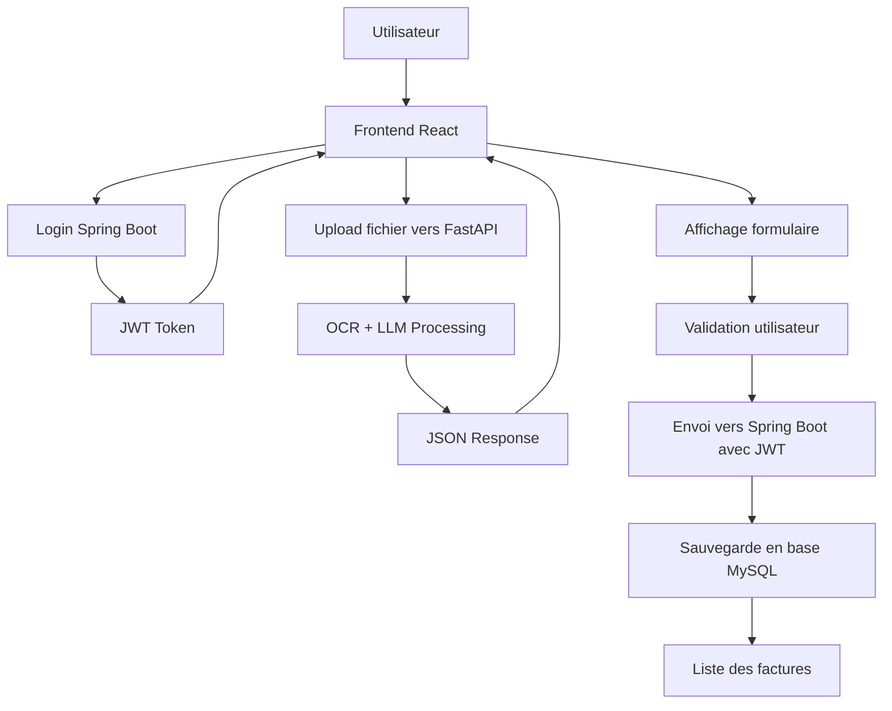

# 🚀 Guide d'Intégration - Système OCR de Factures

## 📋 Vue d'ensemble

Ce projet intègre **3 composants principaux** pour créer un système complet d'extraction et de gestion de factures :

- **FastAPI** : API OCR pour l'extraction de données
- **Spring Boot** : Backend d'authentification et persistance
- **React.js** : Interface utilisateur moderne

## 🏗️ Architecture d'Intégration

### Flux de données complet



### Communication entre les services

| Service | Port | Rôle | Authentification |
|---------|------|------|------------------|
| **FastAPI** | 8000 | OCR Processing | ❌ Non |
| **Spring Boot** | 8080 | Auth + Persistence | ✅ JWT |
| **React.js** | 3000 | Interface utilisateur | ✅ JWT |

## 🔧 Configuration des URLs

### Variables d'environnement (Frontend)

```bash
# .env.local
NEXT_PUBLIC_FASTAPI_URL=http://localhost:8000
NEXT_PUBLIC_SPRING_BOOT_URL=http://localhost:8080
```

### Configuration Spring Boot

```properties
# application.properties
spring.datasource.url=jdbc:mysql://localhost:3306/ocr_db
app.jwt.secret=your-secret-key
app.jwt.expiration-ms=3600000
```

## 🔐 Sécurité et Authentification

### Gestion JWT

1. **Login** → Obtenir JWT depuis Spring Boot
2. **Stockage** → localStorage (ou cookies sécurisés)
3. **Headers** → Ajouter JWT dans chaque requête Spring Boot

### Service d'authentification

```typescript
// lib/authService.ts
class AuthService {
  async login(credentials: LoginRequest): Promise<AuthResponse>
  async register(userData: RegisterRequest): Promise<AuthResponse>
  logout(): void
  isAuthenticated(): boolean
  getToken(): string | null
  getAuthHeaders(): Record<string, string>
}
```

## 📊 Endpoints API

### Spring Boot (Authentification requise)

```http
POST /auth/login
POST /auth/register
GET  /api/invoices
POST /api/invoices
GET  /api/invoices/{id}
PUT  /api/invoices/{id}
DELETE /api/invoices/{id}
```

### FastAPI (Sans authentification)

```http
GET  /health
POST /process-invoice
```

## 🎨 Composants React

### Structure des composants

```
frontend/
├── components/
│   ├── InvoiceUpload.tsx    # Upload et traitement OCR
│   ├── InvoiceList.tsx      # Liste des factures
│   ├── Login.tsx            # Authentification
│   ├── Register.tsx         # Inscription
│   └── Dashboard.tsx        # Tableau de bord
├── lib/
│   ├── authService.ts       # Gestion authentification
│   ├── apiClient.ts         # Client API centralisé
│   └── errorHandler.ts      # Gestion des erreurs
└── app/
    └── page.tsx             # Page principale
```

### Flux d'utilisation

1. **Authentification** → Login/Register
2. **Upload** → Sélection fichier + traitement OCR
3. **Validation** → Correction des données extraites
4. **Sauvegarde** → Envoi vers Spring Boot
5. **Consultation** → Liste des factures

## 🛡️ Gestion des erreurs

### Types d'erreurs gérées

- **Erreurs réseau** : Connexion, timeout
- **Erreurs d'authentification** : Token expiré, non autorisé
- **Erreurs de validation** : Données invalides
- **Erreurs de fichier** : Type non supporté, taille excessive
- **Erreurs OCR** : Traitement échoué

### Validation des données

```typescript
// Validation côté client
const validationErrors = validateInvoiceData(ocrData)
if (validationErrors.length > 0) {
  setError(validationErrors.join(", "))
  return
}
```

## 🚀 Démarrage rapide

### 1. Base de données MySQL

```sql
CREATE DATABASE ocr_db;
```

### 2. Spring Boot

```bash
cd backendSpring
./mvnw spring-boot:run
```

### 3. FastAPI

```bash
cd FASTAPI
pip install -r requirements.txt
uvicorn app:app --reload --port 8000
```

### 4. React.js

```bash
cd frontend
npm install
npm run dev
```

## 📝 Exemples d'utilisation

### Upload et traitement d'une facture

```typescript
// 1. Upload vers FastAPI
const response = await apiClient.uploadFile<OCRData>(file)
const invoiceData = response.data

// 2. Affichage des données
setOcrData(invoiceData)

// 3. Sauvegarde vers Spring Boot
await apiClient.createInvoice(invoiceRequest)
```

### Authentification

```typescript
// Login
const authResponse = await authService.login({
  username: "user",
  password: "password"
})

// Vérification
if (authService.isAuthenticated()) {
  // Utilisateur connecté
}
```

## 🔍 Structure des données

### Format OCR (FastAPI)

```json
{
  "fournisseur": {
    "ice": "string",
    "if": "string",
    "raison_sociale": "string",
    "cnss": "string",
    "rc": "string",
    "patente": "string",
    "adresse": "string"
  },
  "client": {
    "ice": "string",
    "raison_sociale": "string"
  },
  "facture": {
    "numero_facture": "string",
    "date_facture": "YYYY-MM-DD",
    "date_echeance": "YYYY-MM-DD",
    "date_livraison": "YYYY-MM-DD",
    "montant_ht": 0.0,
    "montant_tva": 0.0,
    "taux_tva": 0,
    "montant_ttc": 0.0
  }
}
```

### Format Spring Boot

```json
{
  "supplierIce": "string",
  "supplierIf": "string",
  "supplierRc": "string",
  "supplierPatente": "string",
  "supplierCnss": "string",
  "supplierName": "string",
  "supplierAddress": "string",
  "clientIce": "string",
  "clientName": "string",
  "invoiceNumber": "string",
  "invoiceDate": "YYYY-MM-DD",
  "dueDate": "YYYY-MM-DD",
  "deliveryDate": "YYYY-MM-DD",
  "amountHt": 0.0,
  "amountTva": 0.0,
  "tvaRate": 0,
  "amountTtc": 0.0,
  "originalFilename": "string",
  "isValidated": true
}
```

## 🛠️ Bonnes pratiques

### Sécurité

- ✅ Validation côté client ET serveur
- ✅ Gestion des tokens JWT
- ✅ Validation des types de fichiers
- ✅ Gestion des erreurs centralisée

### Performance

- ✅ Client API centralisé
- ✅ Gestion des états de chargement
- ✅ Validation en temps réel
- ✅ Nettoyage des fichiers temporaires

### UX/UI

- ✅ Feedback visuel (loading, success, error)
- ✅ Interface responsive
- ✅ Validation en temps réel
- ✅ Messages d'erreur clairs

## 🐛 Dépannage

### Problèmes courants

1. **CORS** : Configurer les headers CORS dans FastAPI
2. **JWT expiré** : Vérifier la configuration du token
3. **Fichier trop volumineux** : Ajuster les limites
4. **OCR échoue** : Vérifier le format du fichier

### Logs utiles

```bash
# Spring Boot
tail -f logs/spring.log

# FastAPI
uvicorn app:app --reload --log-level debug

# React
npm run dev -- --verbose
```

## 📈 Améliorations futures

- [ ] Cache des résultats OCR
- [ ] Support de plus de formats
- [ ] Statistiques avancées
- [ ] Export des données
- [ ] API de recherche
- [ ] Notifications en temps réel

---

## 🎯 Résumé

Cette intégration permet de :

1. **Authentifier** les utilisateurs via Spring Boot
2. **Extraire** les données de factures via FastAPI + OCR
3. **Valider** et corriger les données côté React
4. **Sauvegarder** les factures validées en base MySQL
5. **Consulter** l'historique des factures

Le système est **modulaire**, **sécurisé** et **extensible** pour répondre aux besoins d'un système OCR professionnel.
