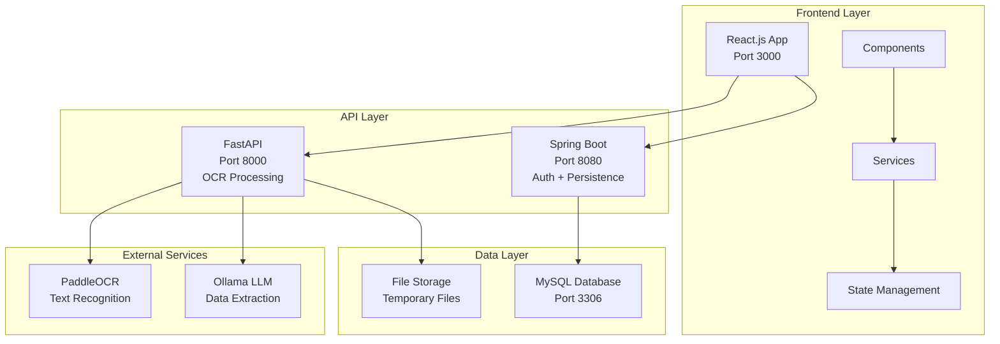
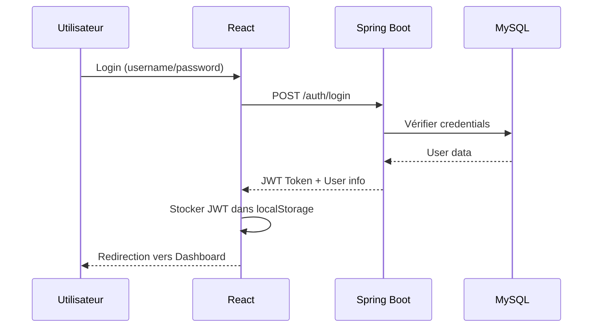
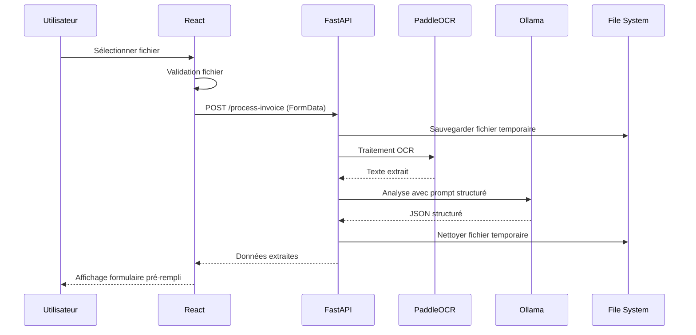
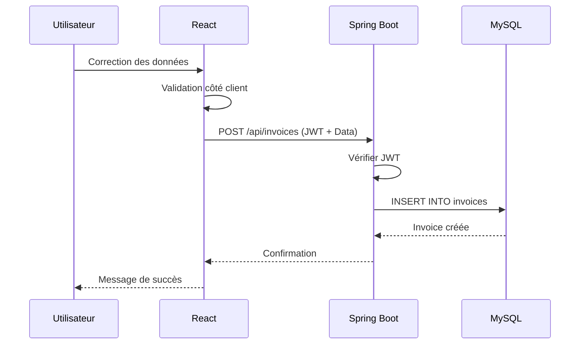

# 🚀 Système OCR de Factures - Architecture d'Intégration

## 📊 Diagramme d'Architecture



## 🔄 Flux de Données Détaillé

### 1. Authentification


### 2. Upload et Traitement OCR


### 3. Validation et Sauvegarde


## 🏗️ Structure des Services

### Frontend (React.js)
```
frontend/
├── app/
│   └── page.tsx                 # Point d'entrée
├── components/
│   ├── InvoiceUpload.tsx        # Upload + OCR
│   ├── InvoiceList.tsx          # Liste factures
│   ├── Login.tsx               # Authentification
│   ├── Register.tsx            # Inscription
│   └── Dashboard.tsx           # Tableau de bord
├── lib/
│   ├── authService.ts          # Gestion JWT
│   ├── apiClient.ts            # Client API
│   └── errorHandler.ts         # Gestion erreurs
└── components/ui/              # Composants UI
```

### Backend Spring Boot
```
projetStageOcr/
├── src/main/java/com/example/projetstageocr/
│   ├── controller/
│   │   ├── AuthController.java      # Login/Register
│   │   └── InvoiceController.java   # CRUD Factures
│   ├── entity/
│   │   ├── User.java               # Entité utilisateur
│   │   └── Invoice.java            # Entité facture
│   ├── service/
│   │   ├── AuthService.java        # Logique auth
│   │   └── InvoiceService.java     # Logique factures
│   ├── repository/
│   │   ├── UserRepository.java     # DAO utilisateur
│   │   └── InvoiceRepository.java   # DAO facture
│   ├── security/
│   │   ├── JwtService.java         # Gestion JWT
│   │   └── SecurityConfig.java     # Configuration sécurité
│   └── dto/
│       ├── AuthResponse.java       # Réponse auth
│       ├── InvoiceRequest.java     # Requête facture
│       └── InvoiceResponse.java    # Réponse facture
```

### API OCR (FastAPI)
```
FASTAPI/
├── app.py                        # API principale
├── paddletest.py                 # Logique OCR + LLM
└── requirements.txt              # Dépendances Python
```

## 🔐 Sécurité et Authentification

### JWT Flow


### Configuration Sécurité
```java
// SecurityConfig.java
@Configuration
@EnableWebSecurity
public class SecurityConfig {
    
    @Bean
    public SecurityFilterChain filterChain(HttpSecurity http) {
        return http
            .csrf(csrf -> csrf.disable())
            .sessionManagement(session -> session.sessionCreationPolicy(SessionCreationPolicy.STATELESS))
            .authorizeHttpRequests(auth -> auth
                .requestMatchers("/auth/**").permitAll()
                .requestMatchers("/api/**").authenticated()
                .anyRequest().authenticated()
            )
            .addFilterBefore(jwtAuthenticationFilter(), UsernamePasswordAuthenticationFilter.class)
            .build();
    }
}
```

## 📊 Modèles de Données

### Entité Invoice (Spring Boot)
```java
@Entity
@Table(name = "invoices")
public class Invoice {
    @Id
    @GeneratedValue(strategy = GenerationType.IDENTITY)
    private Long id;
    
    @ManyToOne(fetch = FetchType.LAZY)
    @JoinColumn(name = "user_id", nullable = false)
    private User user;
    
    // Fournisseur
    private String supplierIce;
    private String supplierIf;
    private String supplierRc;
    private String supplierPatente;
    private String supplierCnss;
    private String supplierName;
    private String supplierAddress;
    
    // Client
    private String clientIce;
    private String clientName;
    
    // Facture
    private String invoiceNumber;
    private LocalDate invoiceDate;
    private LocalDate dueDate;
    private LocalDate deliveryDate;
    private BigDecimal amountHt;
    private BigDecimal amountTva;
    private Integer tvaRate;
    private BigDecimal amountTtc;
    
    // Métadonnées
    private String originalFilename;
    private String filePath;
    private Double ocrConfidence;
    private Boolean isValidated;
    private LocalDateTime createdAt;
    private LocalDateTime updatedAt;
}
```

### Format OCR Response (FastAPI)
```json
{
  "fournisseur": {
    "ice": "string",
    "if": "string", 
    "raison_sociale": "string",
    "cnss": "string",
    "rc": "string",
    "patente": "string",
    "adresse": "string"
  },
  "client": {
    "ice": "string",
    "raison_sociale": "string"
  },
  "facture": {
    "numero_facture": "string",
    "date_facture": "YYYY-MM-DD",
    "date_echeance": "YYYY-MM-DD", 
    "date_livraison": "YYYY-MM-DD",
    "montant_ht": 0.0,
    "montant_tva": 0.0,
    "taux_tva": 0,
    "montant_ttc": 0.0
  }
}
```

## 🛡️ Gestion des Erreurs

### Types d'Erreurs
```typescript
export interface ApiError {
  message: string
  status?: number
  code?: string
  details?: any
}

export class AppError extends Error {
  public status?: number
  public code?: string
  public details?: any
}
```

### Codes d'Erreur
- **400** : Validation des données
- **401** : Non authentifié
- **403** : Accès refusé
- **404** : Ressource non trouvée
- **413** : Fichier trop volumineux
- **415** : Type de fichier non supporté
- **500** : Erreur serveur

## 🚀 Déploiement

### Variables d'Environnement

#### Frontend (.env.local)
```bash
NEXT_PUBLIC_FASTAPI_URL=http://localhost:8000
NEXT_PUBLIC_SPRING_BOOT_URL=http://localhost:8080
```

#### Spring Boot (application.properties)
```properties
spring.datasource.url=jdbc:mysql://localhost:3306/ocr_db
spring.datasource.username=root
spring.datasource.password=
app.jwt.secret=your-secret-key
app.jwt.expiration-ms=3600000
```

#### FastAPI (config.py)
```python
OCR_LANG = "fr"
MODEL = "llama3:latest"
OLLAMA_PATH = "path/to/ollama"
OUTPUT_DIR = "path/to/output"
```

### Commandes de Démarrage

```bash
# 1. Base de données
mysql -u root -p
CREATE DATABASE ocr_db;

# 2. Spring Boot
cd projetStageOcr/projetStageOcr
./mvnw spring-boot:run

# 3. FastAPI  
cd FASTAPI/FASTAPI
pip install -r requirements.txt
uvicorn app:app --reload --port 8000

# 4. React.js
cd frontend
npm install
npm run dev
```

## 📈 Monitoring et Logs

### Logs Spring Boot
```yaml
logging:
  level:
    com.example.projetstageocr: DEBUG
    org.springframework.security: DEBUG
  file:
    name: logs/application.log
```

### Logs FastAPI
```python
import logging
logging.basicConfig(level=logging.DEBUG)
```

### Métriques Utiles
- Nombre de factures traitées
- Taux de succès OCR
- Temps de traitement moyen
- Erreurs par type

## 🔧 Maintenance

### Tâches Régulières
- Nettoyage des fichiers temporaires
- Rotation des logs
- Sauvegarde de la base de données
- Mise à jour des dépendances

### Surveillance
- Monitoring des performances OCR
- Vérification de l'espace disque
- Contrôle de la mémoire
- Alertes sur les erreurs critiques

---

Cette architecture modulaire permet une **séparation claire des responsabilités**, une **scalabilité** et une **maintenabilité** optimales pour le système OCR de factures.
